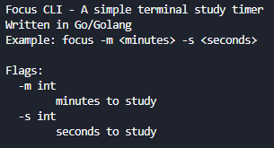

# Focus CLI Tool

This is my first ever CLI tool made in Go, meant to help with your focus and studying. It features a customizable countdown timer right in your terminal and plays a timer bell when your session finishes.

## Description

Focus is a lightweight command-line timer designed to keep you in the zone without leaving your terminal. Whether you are using the Pomodoro technique, timing a quick study sprint, or setting a short break, you can pass in custom minutes and seconds to start a distraction-free countdown immediately. No background apps, browsers, or extra installations required.

### Screenshots



## Getting Started

### Dependencies

* **No programming tools required.** You do not need Go or any extra libraries installed to run this program.
* **Supported Operating Systems:** Windows 10/11, macOS, or Linux.

### Installing

1. Go to the **Releases** page of this repository and download the file for your computer:
   * **Windows:** `focus.exe`
   * **macOS (Apple Silicon / M1–M4):** `focus-mac` (rename to `focus`)
   * **macOS (Intel):** `focus-mac-intel` (rename to `focus`)
   * **Linux:** `focus-linux` (rename to `focus`)

2. *(Optional)* **Run `focus` from anywhere in your terminal:**
   * **Mac & Linux:** Open your terminal in your Downloads folder and run:
     ```bash
     chmod +x focus
     sudo mv focus /usr/local/bin/
     ```
   * **Windows:** Move `focus.exe` to a permanent folder (like `C:\Tools`). Search your Windows Start menu for **Environment Variables**, click **Environment Variables...**, select **Path** under User variables, click **Edit**, and add `C:\Tools`. Restart your terminal afterward.

### Executing program

If you completed the optional global install above, open any terminal window and run:

```bash
focus -m 20 -s 30
```

(Note: if you run `focus` with no flags, you'll just get the normal help screen)

If you skipped the global install, open your terminal inside the exact folder where you downloaded the file and run:

* **Windows:**
  ```powershell
  .\focus.exe -m 20 -s 30
  ```
* **Mac & Linux:**
  ```bash
  ./focus -m 20 -s 30
  ```

#### Common Flags
* `-m` — Number of minutes for the timer
* `-s` — Number of seconds for the timer

## Help

* **Double-clicking the `.exe` closes immediately:** Because this is a terminal tool, you must launch it from Command Prompt, PowerShell, or Terminal rather than double-clicking the file icon.
* **macOS "Unidentified Developer" warning:** Right-click the `focus` file in Finder, select **Open**, and click **Open** on the prompt to allow it to run.
* **View all available commands and flags:**
  ```bash
  focus -h
  ```
* **Any more issues?** Open up a GitHub issue, and I'll look into it as soon as I can.

## License

This project is licensed under the MIT License - see the LICENSE.md file for details
